# Lookuvi product guide

This is the founder’s guide for the seven-salon launch. It is written from the screens and the rules in the code, checked against the local seeded demo on 24 October 2026. The AI engine in that run was mock. No live WhatsApp handset was used, and nothing here was deployed.

Return visits, reminders, offers, and STOP are in the product (merged as PR #28). Queue-on for new salons, plan credits, per-salon STOP, and the Kolkata day are in PR #29. Lite lead export and the credit-floor message are in PR #30. The review that settled those choices is in `docs/DECISIONS.md`.

Demo sign-in, local database only:

| Who | Email | Password |
| --- | --- | --- |
| Owner | owner@demo.agenticbuildworks.com | DemoSalon#2026 |
| Staff | staff@demo.agenticbuildworks.com | DemoStaff#2026 |
| Super admin | super@agenticbuildworks.com | SuperAdmin#2026 |

The public demo is `/s/demo`. The demo WhatsApp number on the seed is 919800011122. It is not a live phone.

## Off for this launch

These exist in the code and stay off until their flag is turned on. Do not promise them.

| Feature | Flag | What the guest or owner sees while it is off |
| --- | --- | --- |
| Guest hub and phone OTP | `FEATURE_GUEST_HUB` | `/s/{slug}/me` is a 404 |
| Bookings calendar | `FEATURE_BOOKINGS` | `/admin/bookings` is a 404 |
| Custom domain and outlets | `FEATURE_CUSTOM_DOMAIN`, `FEATURE_OUTLETS` | No domain or outlet controls |
| Salon’s own AI key | `FEATURE_SALON_AI` | No AI settings page for the owner |
| Embed and in-salon guide | `FEATURE_EMBED`, `FEATURE_GUIDE` | `/embed/{slug}` and `/s/{slug}/guide` are 404s |
| Owner self-serve billing | Production with mock billing | The owner sees “Contact Lookuvi to activate your plan.” Local development does not apply that lock. |
| Guest OTP login | `OTP_PROVIDER` | Not a sign-in method |

Groom try-on is a product switch, default off. It is not one of the flags above. Turn it on only for a salon that asked for it.

Lite’s “2 languages” is also not enforced. An owner on Lite can save more than two languages. Say that out loud if a salon asks. It is a known gap, not a silent limit.

## How an address works

A guest opens `https://{slug}.try.{your domain}` or `/s/{slug}`. On this machine the salon host is `{slug}.localhost`, which rewrites to `/s/{slug}`. A custom host rewrites to `/s/by-host`. Unknown slugs are a 404.

If the salon is suspended, every public page is the paused screen: the salon name, “This salon is paused”, and a line to call or message them. The owner can still sign in.

If try-on, bridal, and groom are all off, and the queue is on, `/s/{slug}` redirects to the queue. If the queue is off as well, the page says try-on is not available.

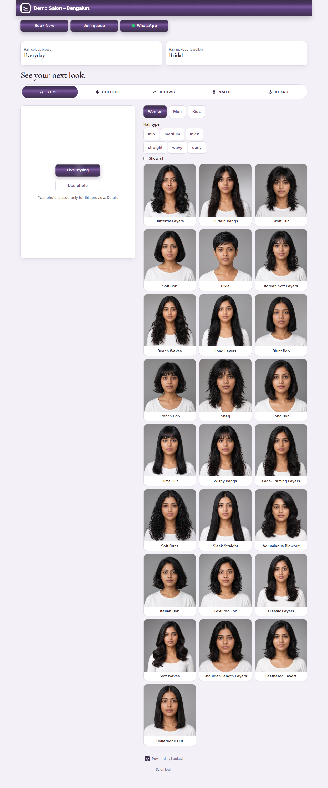

## Customer

### Everyday try-on

The tabs follow the salon. Everyday tools are hairstyle, live colour, brows, nails, and beard. Each tool can be turned off. Colour is free of the credit pack: a mock or provider preview of colour still has to pass the daily and monthly caps, and a mock sample is labelled rather than billed.

The guest picks women, men, or kids when those audiences are on, picks a look, adds a photo, and runs it. Hair suggestions are an owner switch. The try-on uses the salon’s default language. There is no guest language switcher in this launch.

A photo must be JPEG, PNG, or WebP, under 2 MB, at least 64 pixels on the short side. Sending the photo is the consent. The photo notice API still refuses a submission that does not accept the notice and the age gate. Nails and mehendi reject a picture the classifier calls a face. Brows, beard, and colour can refuse a pose when the browser sends face landmarks.

The result is a before/after, a zoom, a JPEG download, and a WhatsApp share. With no provider key the image is a labelled sample (`x-demo-reason: no-key`). The credit balance does not move, and the row is stored as DEMO, so it does not count toward the succeeded caps.

### Bridal

Bridal is on by default. The stepper is event, makeup, hair, and mehendi, then the bride’s own saree, blouse, jewellery, and other optional slots. “My looks” is stored in that browser only, up to six, and can compare two. It does not sync to the salon.

Bridal and groom previews share a visit budget. The default is 3 tries for that browser session. The owner can set 1 to 20. Staff can add a bonus from the desk with the session code. The bonus is on top of the limit. A mock sample does not consume the budget, because the budget counts succeeded previews. A real provider success does.

Own saree and jewellery call OpenAI only. With no key the API says to add one, and it does not fall through to another model. This launch run had no key, so that path was refused before any paid call.

### Book this look

The button creates a lead and opens WhatsApp with the look name, shade, and services. If the salon has no WhatsApp number, the guest is told to ask the salon to add one. Suspended salons do not take leads.

`requireLoginToBook` makes the guest sign in with a phone before the request. It is off by default, so Book opens WhatsApp. Phone login itself is off for this launch, so leave the switch off unless that flag is on.

Lead status on the desk moves New → Contacted → Booked → Closed → New. The list keeps up to 40 dated bridal leads and 80 recent leads. Download CSV is Starter and Pro. Lite keeps the list and does not get the file.

### The queue, from the guest’s phone

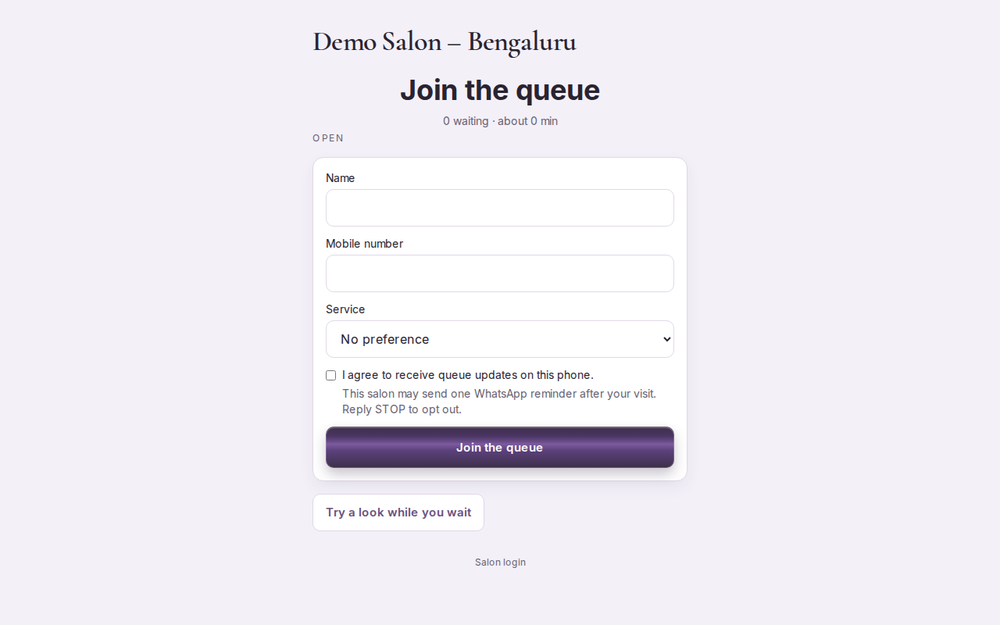

The line is either live or by request, never both. A live join needs a name, a 10-digit Indian mobile, and the consent tick. The tick says the salon may send one WhatsApp reminder after the visit, and that STOP opts out. The same phone keeps one open token for that salon day instead of taking a second number.

The token is one higher than the highest token that salon already issued for the day. People ahead are anyone in a chair, then anyone already called, then earlier waiting tokens. The wait is the sum of their minutes, divided by the number of chairs, rounded up. A service with a duration uses that duration. Otherwise the salon average is used (default 20, range 5–240).

Joins are limited to 60 per connection per hour, 4 per phone per hour, and 8 per device per hour. A paused line refuses a join and tells the guest to ask at the desk.

The ticket page polls. The guest can say they are on the way, or cancel, until the visit is in service or done.

Time-request mode asks for today or a later date and a time. The desk confirms or declines. Walk-in and Next do not exist in this mode.

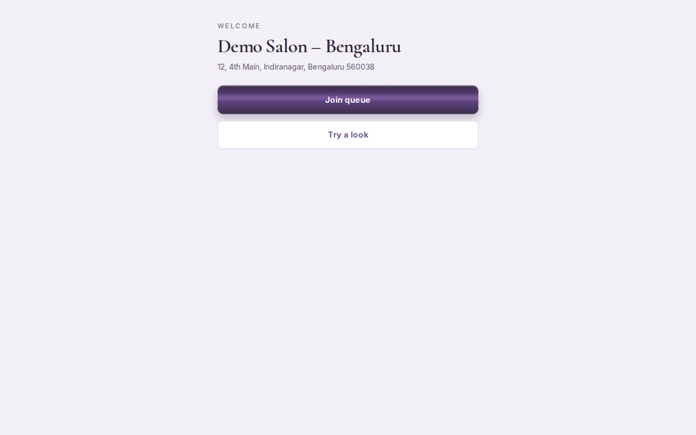

The printed QR points at `/s/{slug}/welcome`, not straight at the try-on. On localhost the QR API refuses to draw a code and says to set a real domain first. Do not print the local page.

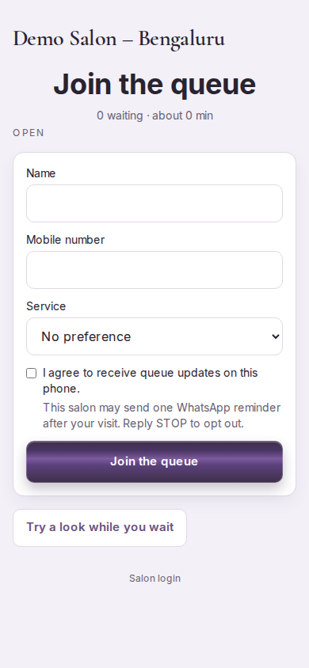

### Privacy

`/privacy` and `/terms` are public. A guest can ask for access, deletion, or withdrawal of a session. Withdrawal removes that session’s leads when a consent row exists. Preview files follow the retention job. The privacy page includes the reminder sentence from the queue consent.

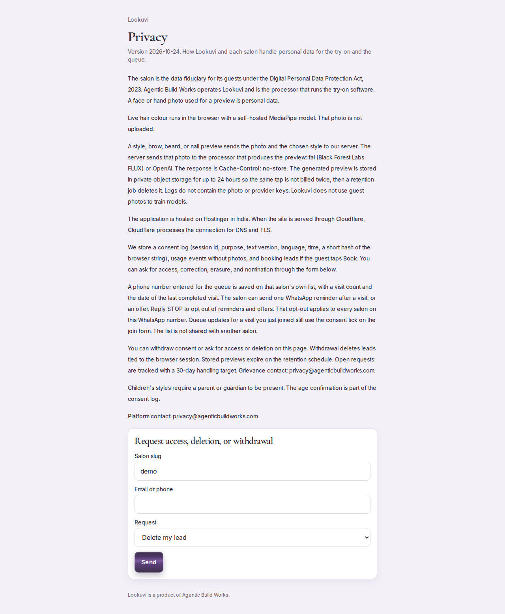

## Staff

Staff sign in on the same page as the owner. There is no magic-link form. Forgot password asks for an email and does not say whether the account exists. In local development, when mail is not configured, the reset response can include a dev link. Production does not.

With the queue on, `/admin` opens the queue desk. With the queue off, it opens leads.

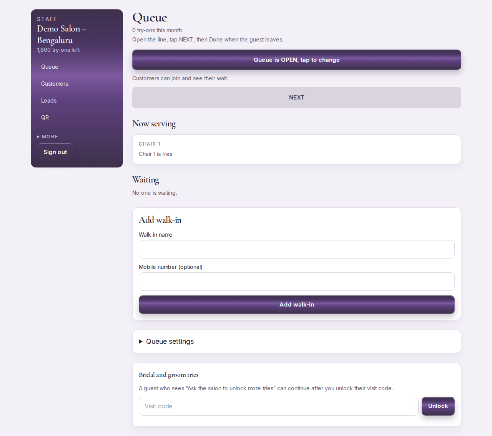

On a live desk the staff can open or pause the line, call Next, start a called guest, mark Done, or mark no-show. The desk polls about every 2.5 seconds. Next does nothing useful when nobody is waiting. Next is refused while every chair is busy: “Every place is busy. Mark one done first.”

A walk-in can omit the phone. A bad phone is refused. Walk-in is refused in request mode.

The WhatsApp button on a card opens `wa.me` on the staff phone with the token and the join and try-on links. It is not a platform send and it does not use the monthly WhatsApp cap. The call link is `tel:`.

In request mode the staff confirm, decline, or mark visited. Mark visited and Done both record a customer visit and arm the reminder, unless that phone is already stopped.

Staff can add a customer, import up to 500 lines, search (the list shows at most 100), and stop reminders at the desk. They cannot turn a desk stop back on, send an offer, or change the reminder settings. Those are owner actions. A real STOP cannot be undone by anyone at the salon.

Staff cannot save settings, team, or billing. They can open Security to change their own password. They cannot enroll the platform authenticator.

If a person belongs to more than one salon, the switcher sets the `helix_salon` cookie. Switching to a salon they are not in is refused.

## Owner

The first-run wizard is Brand, Services, WhatsApp, Languages, Done. It stays in the nav for the owner and for staff until Finish.

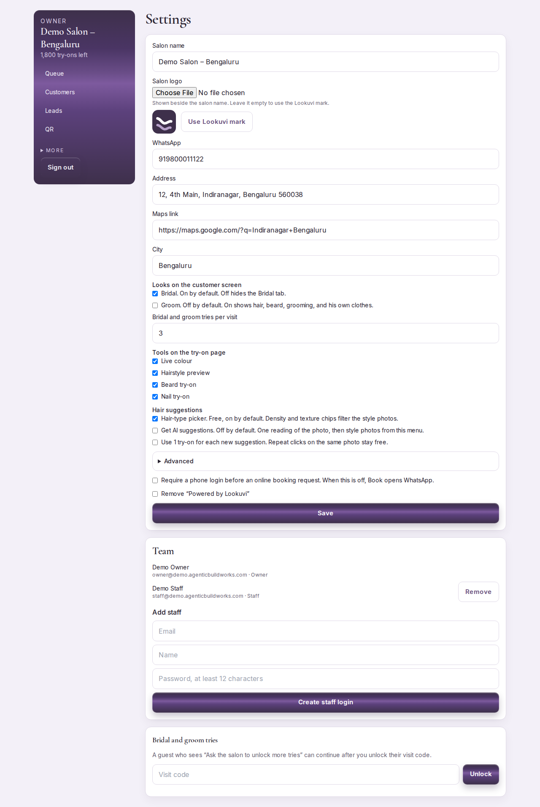

Settings holds the name (2–80 characters), logo, two hex colours, WhatsApp, address, map link, city, languages, and the default language. The guest page and the QR use that name, logo, colours, and WhatsApp number.

Tool switches, audiences, and hair suggestions are here. Visit tries are 1–20. Anonymous and member daily caps are 0–500. The monthly try-on allowance is 0–5000. Removing the Lookuvi mark is Pro only. A Starter salon that tries is told it needs Pro or Chain.

Chairs are not on this page. They are on the queue desk: 1–30 chairs, stations, or rooms, average minutes 5–240, alert lead 0–120. The public board shows the label the desk saved.

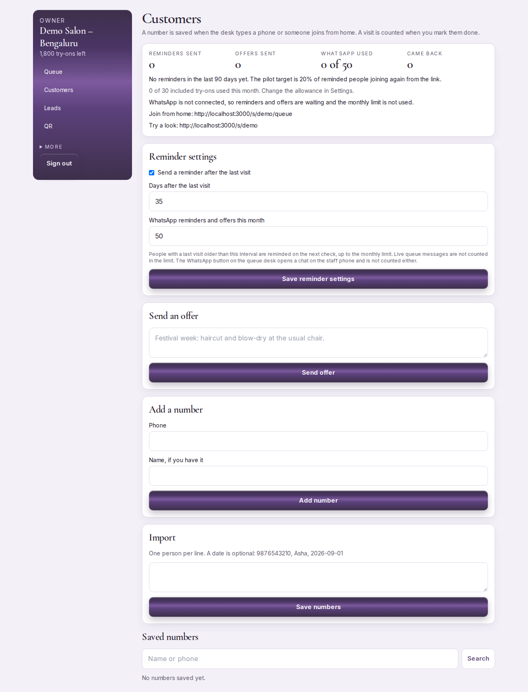

Customers is in the nav only when the queue product is on. The owner sets reminders on or off (on by default), the gap at 28–42 days (default 35), and the monthly WhatsApp cap at 0–5000 (default 50). The cap counts reminders and offers that are sent or still pending. It does not count queue alerts or the desk’s own WhatsApp button.

The page shows how many of the monthly try-ons are used, and says to change that number in Settings. A number that replied STOP stays off. A number stopped at the desk can be turned back on by the owner. The 90-day return rate is the joins that came back through a reminder link (`?r=`).

An offer is at most 180 characters. Under three characters is refused. If WhatsApp is not connected, the owner is told nothing was sent and the cap is not used.

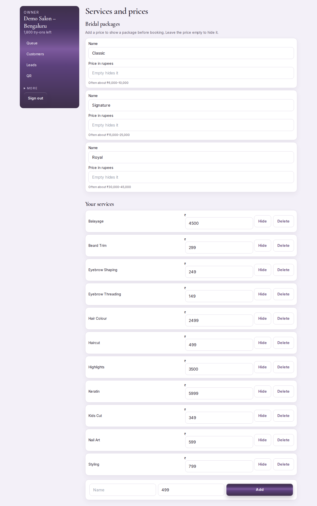

A service key is lowercase letters, numbers, and hyphens. Price is 0–500000 rupees. Duration is 5–480 minutes, and it feeds the queue wait. The add form suggests 499. A bridal package with an empty price is hidden from the guest. The owner cannot delete the salon from Settings. Closing a salon is a support action.

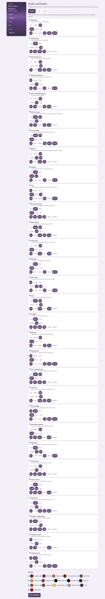

Styles and shades can be renamed, enabled, or disabled. Only Lite has a ceiling, 25 styles. The error names the plan: “Lite includes 25 styles.” A disabled style cannot be booked.

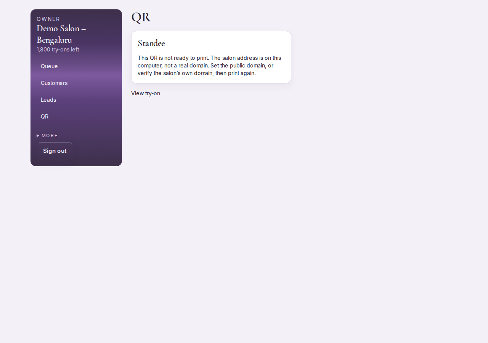

The salon-mode link is a rotating token. While a guest holds it, the anonymous daily cap does not apply. Rotate it when a tablet should stop working. The printable QR is the welcome code, and it will not render on localhost.

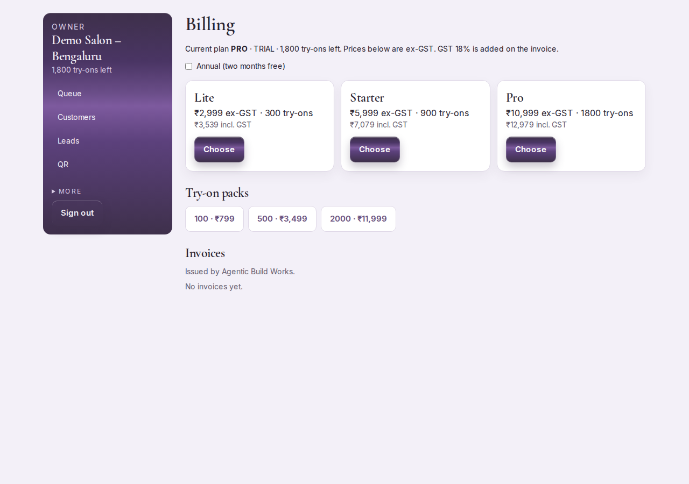

Billing on a production server with the mock provider tells the owner to contact Lookuvi. Do not turn on self-serve for the seven salons.

Team invites need a new password of at least 12 characters that is not one of the demo passwords. A super-admin email cannot be invited. The last owner cannot be removed. An owner cannot remove themselves when they are the only owner.

## Super admin

Sign-in is the same email and password page. In production, a super admin with no authenticator is sent to Security before any other platform page, and the platform APIs refuse them. This development server does not apply that gate. The production path was not executed here.

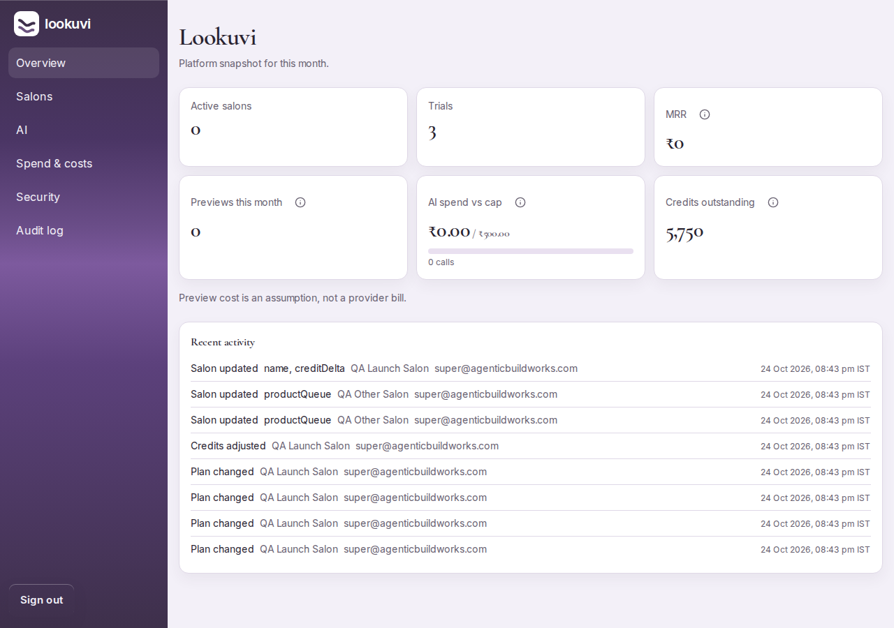

Overview is the month’s snapshot: trials, active salons, ex-GST MRR of active plans, and recent audit lines. A salon owner who opens `/super` is redirected to login. The navigation chrome can appear in the first bytes of the response. Salon names, credits, and leads are not in that response. The APIs return 403.

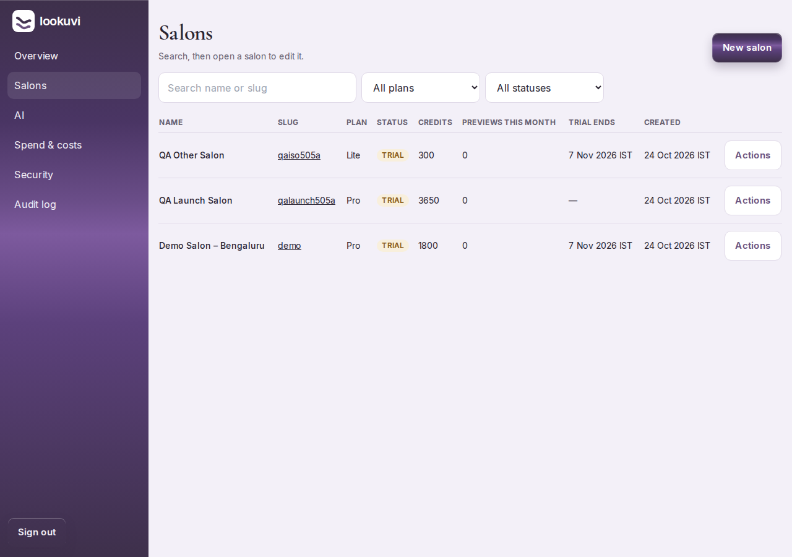

Create asks for name, slug, plan, city, WhatsApp, and the owner’s email, name, and password. The slug is lowercase words. Reserved words such as `admin` and `api` are refused. A duplicate slug is refused. The new salon is a 14-day trial, the queue is on, the line is open with one chair, and styles and shades are copied on. The plan’s tries are granted once. The mark is set to that same number so a later plan click does not grant them again.

Editing a plan grants only the gap between the highest plan already given and the new plan. Pro after Starter adds 900, not another 1800. Doing it again adds nothing. A downgrade adds nothing and does not take tries away. The daily preview cap moves to the new plan’s number only when it still equals the previous plan’s number. A custom daily cap stays.

Goodwill is a separate credit delta. It does not move the mark. The balance cannot go below zero. The screen says so, and the balance stays where it was. Products (try-on, queue, bridal, groom) are switches on the same salon. Turning the queue off hides Customers and the public line for that salon only.

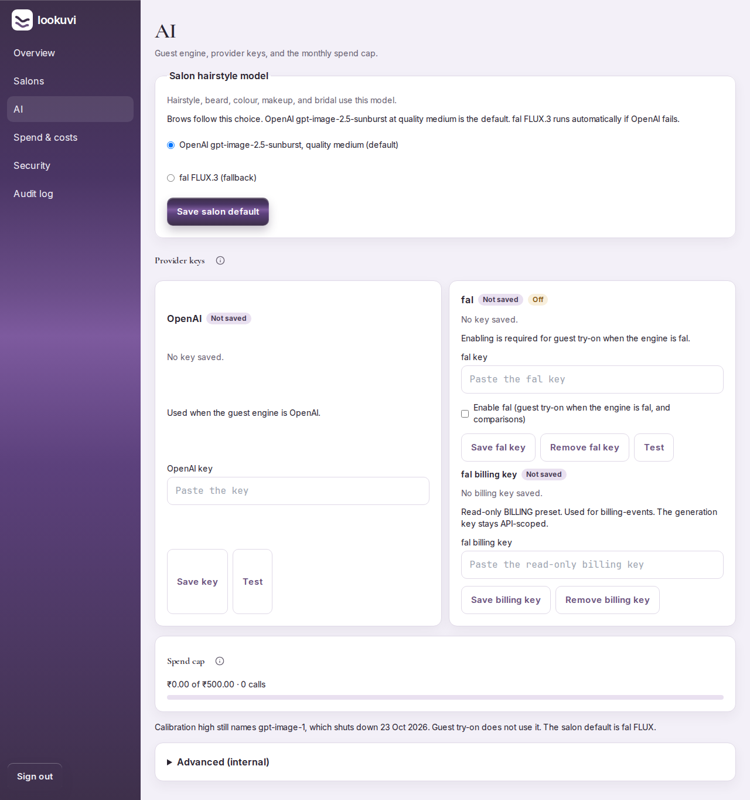

AI settings hold the engine, encrypted keys, the tier, and the spend cap. The page does not echo a raw key. This launch used mock. Do not paste a live key to rehearse.

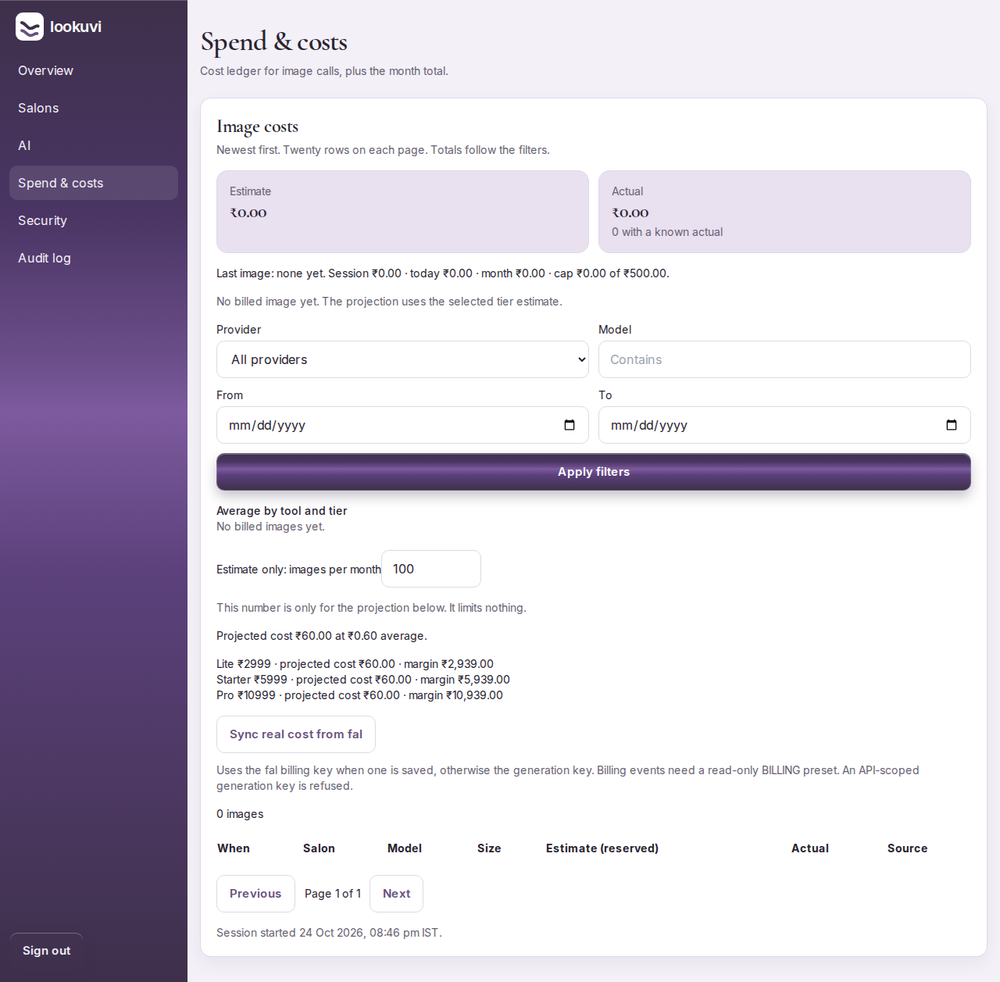

Costs are the platform view of spend. A salon owner cannot open them.

## What one screen does to another

- Chairs, the average, and a service duration change the wait on the guest’s ticket. The ticket updates on the guest poll after Next, Start, Done, or no-show.
- Switching live to request does not convert tokens already issued. Walk-in and Next stop working. Existing live rows stay in their old status.
- Done on the live desk, and Mark visited on a request, write a customer visit and arm the reminder. A join with `?r=` from that reminder is the return the Customers page counts.
- Name, logo, colours, and WhatsApp show on the guest page, the book link, and the QR.
- Suspending a salon shows the paused page to guests and still lets the owner sign in.
- The four limits are different. The plan balance is tries bought or granted. The monthly allowance is succeeded previews this Kolkata month, including staff. The anonymous and member daily caps are per person, per Kolkata day. The salon daily cap is succeeded previews for the whole salon that Kolkata day. Rolling per-hour limits are separate and do not reset at midnight.
- A mock sample does not count as a succeeded preview. A labelled sample at the provider spend cap is the same idea: the guest sees a sample and the credit is not kept.
- STOP from the guest’s reply is stored for the salon the last message belonged to. STOPALL and UNSUBSCRIBE cover every salon on the shared WhatsApp number. A queue “your turn” alert is still sent for a visit they have already joined. The owner cannot undo STOP.
- A customer saved at salon A is invisible to salon B’s search, and salon B cannot change salon A’s lead.

## Plans, in one place

Prices are ex-GST. Invoices add 18 percent. Annual is 10 times monthly.

| | Lite | Starter | Pro |
| --- | --- | --- | --- |
| Monthly | 2999 | 5999 | 10999 |
| Included tries | 300 | 900 | 1800 |
| Styles | 25 | No ceiling | No ceiling |
| Lead export | No | Yes | Yes |
| Remove Lookuvi mark | No | No | Yes |
| Outlets on the price list | 1 | 1 | 3 |

Languages on the Lite price list say 2. The product does not enforce that yet.

New salons start with the queue on. Salons that already existed keep the value they had. A paid renewal, when billing is on, grants one full pack once per payment id and raises the same mark. That path is not part of this launch.

## Videos

Six short recordings, taken after the path worked. They sit with the launch deliverables, not in this folder.

| Area | File | What it shows |
| --- | --- | --- |
| Customer | customer-guest-tryon-queue-welcome.mp4 | Try-on tools, the join form including STOP, and the welcome page. 41 seconds. |
| Staff | staff-queue-desk.mp4 | Staff sign-in, pause, then open. The line is left open. |
| Owner | owner-customers-leads-settings.mp4 | Customers, leads with Download CSV, settings, and services. Nothing is saved. |
| Super admin | super-admin-overview-salons.mp4 | Overview, the salon list, and AI settings with no key entered. |
| Platform | platform-login-and-reset.mp4 | Salon login and the reset page. The reset form is not submitted. |
| Cross-screen | cross-screen-pause-and-guest.mp4 | The desk pauses the line, the guest page says it is paused, then both show open again. |

They are not a substitute for the pass/fail sheet in `docs/test-plan/TEST-PLAN.md`. The join button is disabled while the line is paused, and the API refuses the join as well.
