# Lookuvi

The screens a salon gets on the first day. Master `4e0b8e514a85b211e84d385d759ff204c3b91428`.
The walkthrough video is 13 minutes 49 seconds. Timestamps below match that recording.

## Lookuvi at launch

*For the salon owner, the staff, and the founders*

Lookuvi is the try-on mirror and the token queue for a family salon. A guest does not make an account. The owner and the staff use a phone. The three founders use the super-admin screens. This guide is the set of screens that ship on the first day. Each page names the controls on that screen, what the person should do next, and the rule the screen is enforcing.

**Next.** Start with the plans page, then walk the guest, the owner, the staff, and the founders.

**Rule.** Money, a live AI key, and a WhatsApp handset are not connected in this copy. The screens still show what the salon will see.

## Plans, trial, and try-ons

*Platform*

Basic is ₹799 a month and includes 50 try-ons. Standard is ₹1,499 and includes 120. Pro is ₹2,499 and includes 220. Annual is ten times the monthly price: ₹7,990, ₹14,990, and ₹24,990. Packs are 25 try-ons for ₹299, 60 for ₹649, and 150 for ₹1,499. A new salon starts on a 14-day trial with 20 try-ons. The stored plan ids are LITE, STARTER, and PRO. The screen says Basic, Standard, and Pro.

**Next.** The owner chooses a plan on Billing. A founder marks the UPI reference paid before the plan turns on.

**Rule.** One try-on is one credit. Choosing a plan does not add try-ons. Mark paid does. Change plan does not. With no AI key, a guest sees a sample and the try-on count does not move.

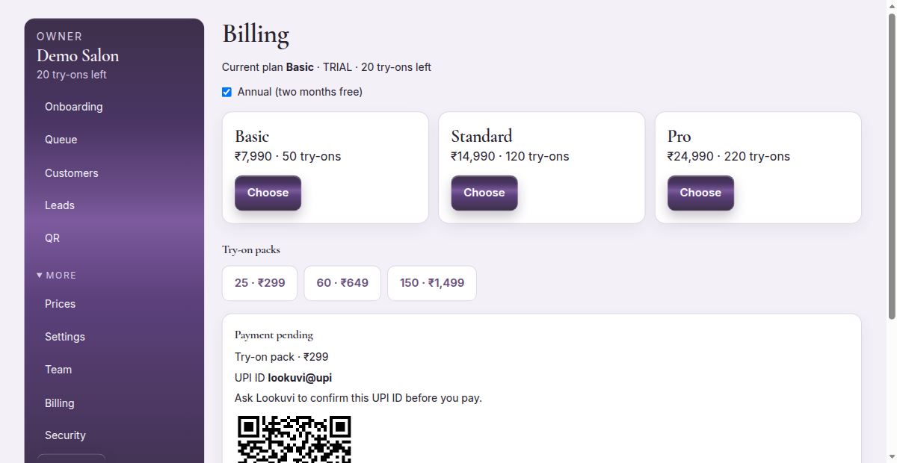

## Guest welcome

*Customer*

The welcome page names the salon. Join queue opens the line. Try a look opens the mirror. There is no account and no password.

**Next.** The guest taps Try a look, or Join queue if they already know the cut they want.

**Rule.** The welcome page is on for this launch. A separate guest hub is switched off.

## Women, Men, and Kids

*Customer*

Three chips filter the style photos: Women, Men, and Kids. The pressed chip is the set on screen. Kids is a full set, not a smaller copy of the women's styles.

**Next.** Tap the chip that matches the person in the chair, then pick a photo.

**Rule.** The salon can hide a set from Settings. A hidden set does not show its chip.

## Hair type and Show all

*Customer*

Density chips are thin, medium, and thick. Curl chips are straight, wavy, and curly. Together they filter the style photos. Show all lists every style photo, not only the hair-type match. If a combination has no photos, the screen says to turn Show all on.

**Next.** Tap the hair that matches, or tick Show all to browse the whole wall.

**Rule.** Density and texture tags are platform data. The owner does not edit them. The founders do, on Styles.

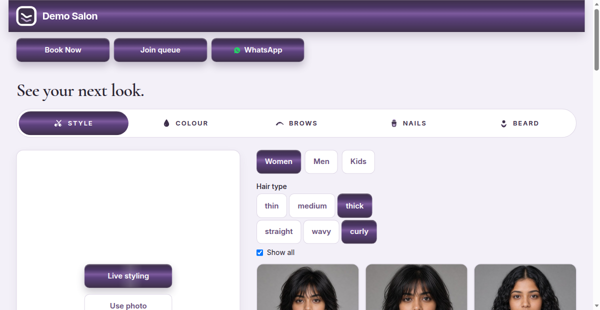

## Style, colour, brows, nails, and beard

*Customer*

The tool tabs are Style, Colour, Brows, Nails, and Beard. Style is the cut. Colour has a strength slider from 20 to 100 once a photo is in. Brows has thickness chips and colour chips. Nails asks for a hand photo. Beard is its own set of shapes. A tab the owner has switched off does not appear.

**Next.** Pick the tool, then the look, then Use photo.

**Rule.** Turning Beard off on Settings removes the Beard tab from the guest page. Turning it back on puts the tab back.

## Colour strength

*Customer*

After a photo is in, the Colour tab shows a strength slider. It runs from 20 to 100 and the number next to it is the strength the next colour preview will use. Moving it does not spend a try-on by itself. The preview spends one only when a provider key is live and the guest generates.

**Next.** Open Colour, set the strength, then pick a shade.

**Rule.** With no AI key the result is still a sample. The slider is there so the salon can see the control the guest will use.

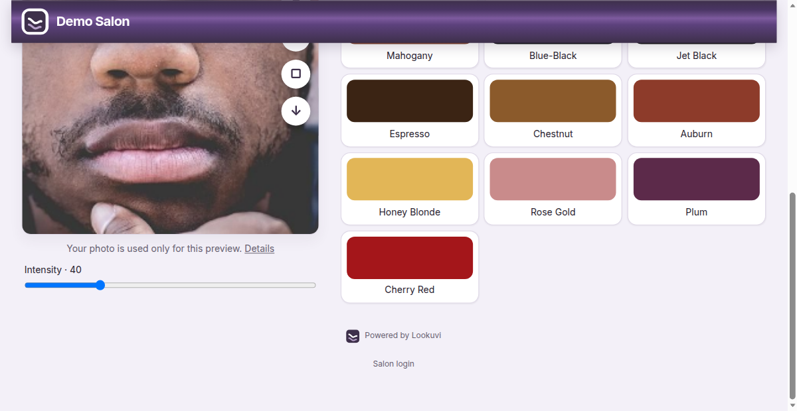

## Photo notice and the result

*Customer*

Use photo opens the notice Before the camera. I agree, start is the only way to the file picker. The result then shows Save, a note if WhatsApp is not connected, and Try another. Save downloads the picture. Try another clears the photo so the guest can take a new one.

**Next.** Agree, choose a photo, tap a style, then Save or try another photo.

**Rule.** With no AI key the picture is a sample. It does not spend a try-on. A paid provider image is not run in this copy.

## Join the queue

*Customer*

The public queue asks for a name, a mobile number, and a service. The consent box must be ticked. The line under it says the salon may send one WhatsApp reminder and that STOP opts out. Join the queue is the submit button. The wait line shows how many people are ahead when the queue is live.

**Next.** Fill the name and the mobile number, tick the box, and join.

**Rule.** The number has to be a 10-digit Indian mobile. The same phone cannot hold two live tokens at that salon on the same day.

## Request a time

*Customer*

When the desk is in request mode, the form adds a date and a time. The button says Request a time. The ticket then says Waiting for the salon to confirm. The guest does not get a token until the desk confirms.

**Next.** Pick today or a later date, pick a time, and request it. Staff confirm it on the desk.

**Rule.** A date in the past is refused. The request stays on the desk until Confirm time or Decline.

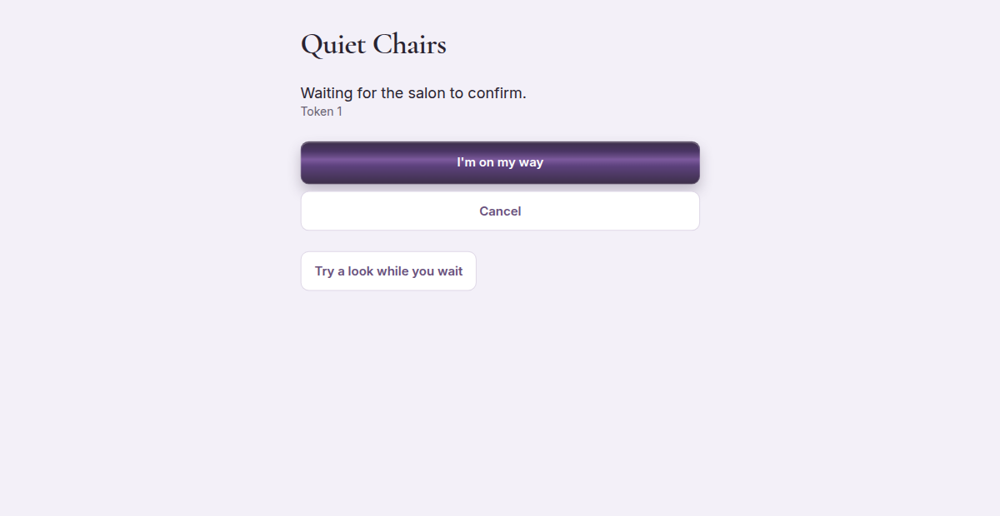

## Ticket states

*Customer*

After a live join the ticket says the guest has joined and shows the token number. NEXT on the desk changes it to Your turn. Start changes it to You are being served. Done changes it to This visit is finished. No-show says the token was marked as a no-show.

**Next.** The guest keeps the ticket open. The desk moves the token. The ticket follows.

**Rule.** The same token is on the guest phone and the desk at the same time. It does not appear on another salon's desk.

## Paused salon and ended trial

*Customer*

A suspended salon says This salon is paused. An expired trial says Trial ended. An unknown link says That page is not here. The owner can still sign in when the guest cannot try on.

**Next.** The guest asks at the desk. The founder resumes a suspended salon. The owner chooses a plan when a trial has ended.

**Rule.** Expired and suspended are different. Resume opens a suspended salon. A trial end is cleared by marking a plan paid, not by resume.

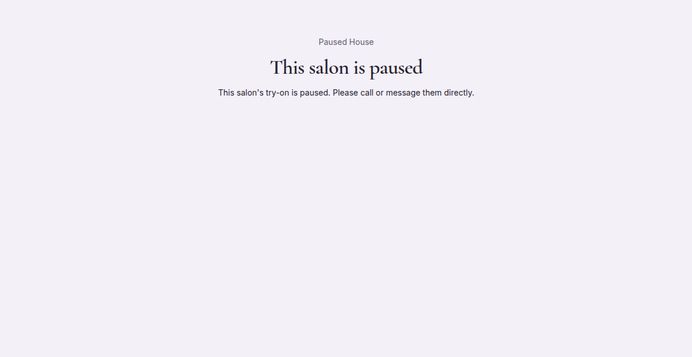

## Terms and privacy

*Customer*

Terms say GST is not charged yet and a receipt is not a tax invoice. Privacy explains the photo rules and has a request form with a Send button for access or deletion.

**Next.** Read Terms before paying. Use the privacy form to ask for a copy or a deletion.

**Rule.** GSTIN is hidden on Settings while GST is off. The receipt download is not a tax invoice.

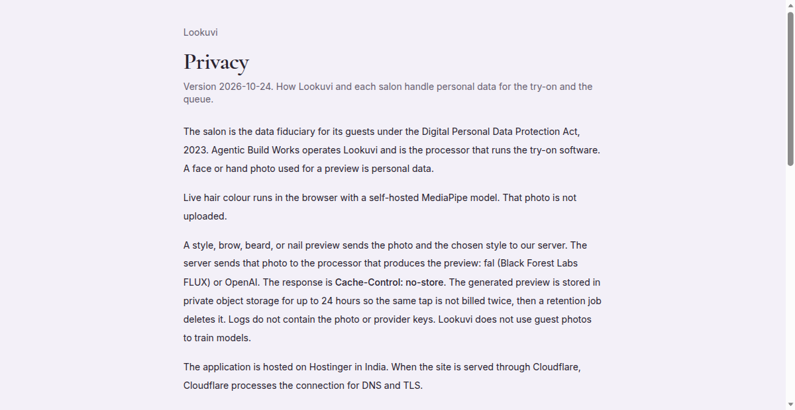

## Hindi and Groom

*Customer*

A salon whose language is Hindi shows the photo button in Hindi. Groom is a tab of its own when the owner has turned it on. Groom has Looks and Your own look. The guest does not get a language dropdown. The salon's language is the language of the screen. Onboarding offers English, हिन्दी, ಕನ್ನಡ, தமிழ், తెలుగు, and मराठी, and the first ticked language is the salon default.

**Next.** The owner sets the language in onboarding. The guest opens the salon link and sees that language.

**Rule.** Groom is off until the owner turns it on. It does not appear on a salon that has not switched it on.

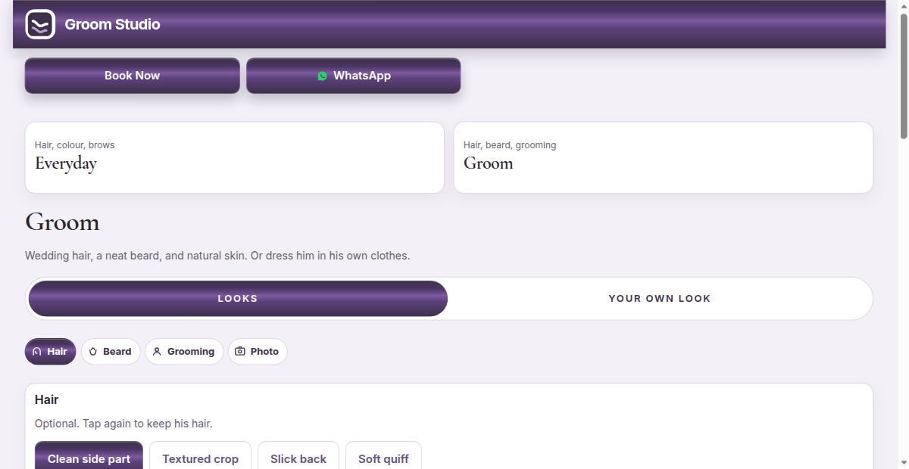

## Bridal tabs

*Customer*

When bridal is on, the guest sees a Bridal tab. Inside it the tabs are Looks, Your own look, Mehendi, and My looks. Looks is the catalogue. Your own look is for a reference the guest brings. Mehendi is the hand. My looks holds pictures the guest saved.

**Next.** Open Bridal, then the tab for the part of the visit.

**Rule.** Bridal is off for a new salon. Packages and the guest tab appear only after the owner turns Bridal on and saves.

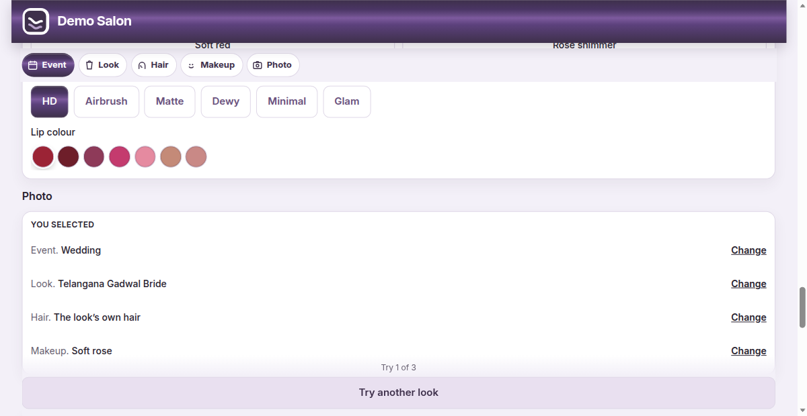

## Bridal package, events, and two tries

*Customer*

Event chips are Wedding, Engagement, Haldi, Mehendi, Sangeet, and Reception. Makeup style and Makeup finish (HD, Airbrush, Matte, Dewy, Minimal, Glam) sit on the same flow. Lip colour is a row of dots. Upload or Take selfie adds the photo. Try now runs the look. A second look in the same visit can be tried after the first. The counter reads Try 1 of 3, then moves only when the try is a billed provider image. A sample does not spend a visit try, so the counter stays on Try 1 of 3 in this copy. Download and Save this look sit on the result.

**Next.** Set the event, upload a photo, tap Try now, then pick a second look and try that too.

**Rule.** The visit budget is three billed tries. The owner prices Classic, Signature, and Royal only while bridal is on. Those packages are created when bridal is turned on, not before.

## Live styling

*Customer*

Live capture opens the camera tray. The pills are Kajal, Lashes, Blush, and Brows, plus the lip dots. Each pill toggles that part of the makeup on the live picture. Close leaves the tray. If the camera cannot start, the screen says so. This copy uses a stand-in camera so the pills can be shown.

**Next.** Tap Live capture, toggle the pills the guest wants, then close the tray and try the look.

**Rule.** Live makeup is part of the bridal look. It is not a separate credit.

## Visit codes and Unlock

*Owner and staff*

When bridal or groom is on, the desk shows Recent visits. Each row is a visit code, how many tries are used, and Unlock. A visit code field does the same job if the guest reads the code out. Unlock adds another batch the size of the salon's visit limit. The note under the field quotes the guest message: Ask the salon to unlock more tries. With bridal and groom both off, this block is hidden. A sample try does not create a visit row. A billed try does. This walk uses a billed visit code, WALK8842, so Unlock can be shown without a provider key.

**Next.** Read the code, tap Unlock, and tell the guest they can try again.

**Rule.** Staff and the owner share this desk. Unlock does not add salon credits. It only adds tries for that visit.

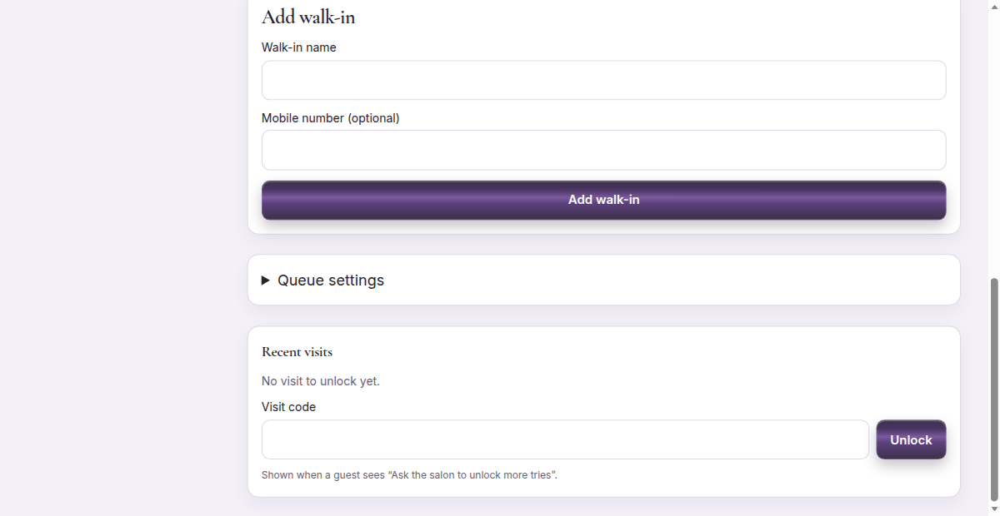

## Owner sign-in

*Owner*

The sign-in form asks for email and password. A wrong password stays on the form and says Those details did not match. A right password opens the desk and shows try-ons left in the menu.

**Next.** Sign in. On a phone, tap Menu to see the rest of the salon.

**Rule.** Staff use their own email. They land on the same desk with fewer powers.

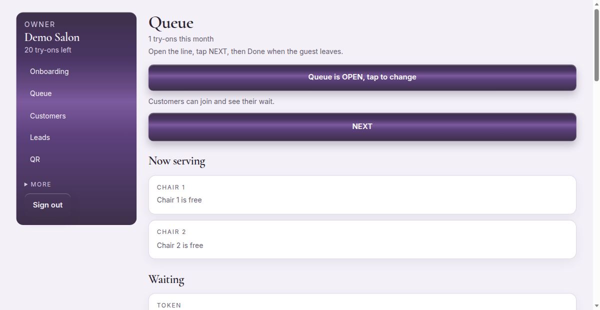

## Onboarding and languages

*Owner*

Onboarding walks the brand, the services, WhatsApp, the languages, and a finish step. Next moves one step. The language step lists English, हिन्दी, ಕನ್ನಡ, தமிழ், తెలుగు, and मराठी. The first language left ticked becomes the guest language.

**Next.** Step through once when the salon is new. The guest page uses that language after Finish.

**Rule.** The guest does not pick a language on the mirror. The salon does.

## The desk and queue settings

*Owner*

The desk shows the line, Add walk-in, and Queue settings. Queue is OPEN, tap to change pauses the line. Chairs working today, the minutes, and the alert are inside Queue settings. Save settings stores them. Live mode gives tokens now. Request mode asks the guest for a date and a time. NEXT, Start, Done, and No-show move a token. The guest ticket follows.

**Next.** Open the desk at the start of the day. Set the chairs, then call NEXT when the chair is free.

**Rule.** A paused queue tells the guest The queue is paused. Please ask at the desk. They cannot join until it is open.

## Prices

*Owner*

Prices is one row per service. Each row has the name, a small rupee field, an on/off switch, and delete behind the more menu. Add creates a row. There is no Styles item in the owner menu. Bridal packages Classic, Signature, and Royal appear only when bridal is on. Turning bridal off removes them. A price such as Classic at 4999 is typed into that row's rupee field.

**Next.** Type the rupee amount and leave the field. The row saves the price. Switch a service off to hide it from the queue form.

**Rule.** Staff who open Prices are told only the owner can change prices.

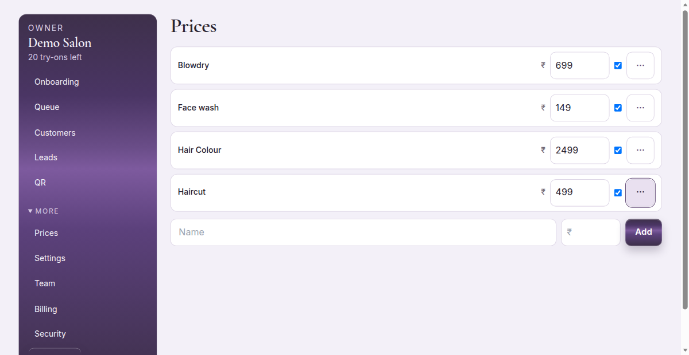

## Customers, reminders, and STOP

*Owner*

Customers shows the counters, Add customer, a CSV upload, reminder days, a monthly cap, an offer, and Search. Phone and name are the fields on the card. Until WhatsApp is connected, a banner says WhatsApp is not connected and reminders are paused. A guest who replies STOP shows as Replied STOP. Staff cannot turn that back on.

**Next.** Add the regulars, or upload a CSV. Leave reminders paused until a WhatsApp number is connected.

**Rule.** STOP is stored. The salon must not message that number again.

## Settings, bridal, and groom

*Owner*

Settings holds the salon name, the WhatsApp number, the address, the tool switches, Bridal, Groom, and Save. The tool switches cover live colour, hairstyle, beard, and nails. Save writes the page. Bridal on creates the packages and the guest Bridal tab. Bridal off hides both. Groom on adds the Groom tab. GSTIN is not on this page while GST is off.

**Next.** Turn on only the tools the salon offers, save, then open the guest link and check the tabs.

**Rule.** Staff who open Settings are told they cannot change settings or prices.

## Team

*Owner*

Team sits on Settings. It lists the people who can sign in and can create a staff login. The staff member is marked STAFF.

**Next.** Add a staff login for the person on the desk. Do not share the owner password.

**Rule.** A staff login cannot change settings, prices, or the plan.

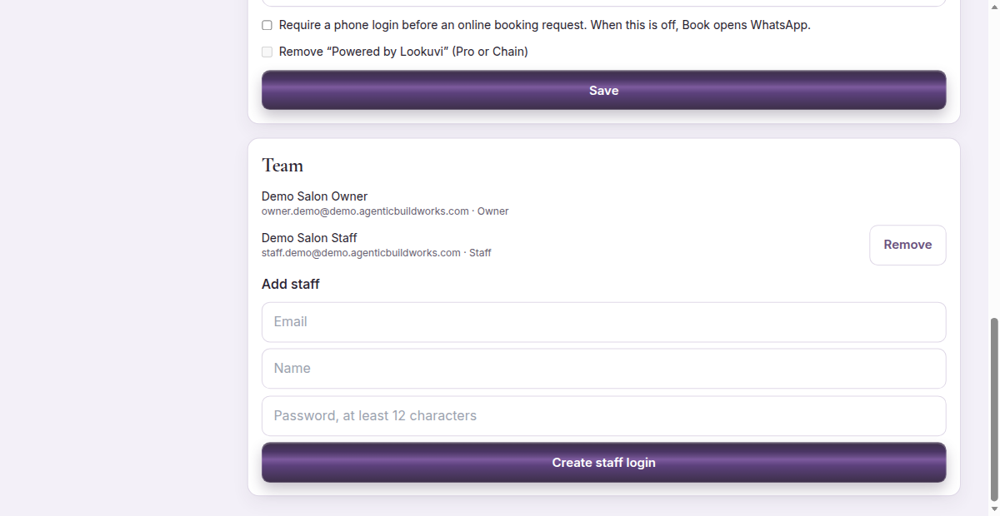

## QR

*Owner*

QR prints the salon link as a code once a public website address is saved. On a local address the page says to add the public website address first. It does not invent a code that a phone camera cannot open.

**Next.** Add the public website address in Settings, then come back and print the code for the mirror and the counter.

**Rule.** A handset scan of a public code is not verified in this copy.

## Billing, UPI, and the receipt

*Owner*

Billing lists Basic, Standard, and Pro, an Annual switch, and the packs. Annual shows Basic at ₹7,990. Choose opens a UPI QR for lookuvi@upi and the words Payment pending. A pack does the same. Nothing activates until a founder marks that UPI reference paid. After that, the receipt number is on this page and Download saves the PDF. The PDF is a receipt, not a tax invoice.

**Next.** Choose the plan, pay from the salon's UPI app, and send the reference to a founder. Download the receipt after it is marked paid.

**Rule.** The same UPI reference cannot be used twice. Change plan does not add try-ons. Mark paid adds them once.

## Leads

*Owner*

Leads lists people who tried a look and left a way to be contacted. Standard and Pro can download a CSV. Basic is told that export is not on that plan. The sentence is the control. There is no download button on Basic.

**Next.** On Standard or Pro, download the CSV when the front desk wants a list. On Basic, upgrade first.

**Rule.** Export follows the plan. It is not a staff control.

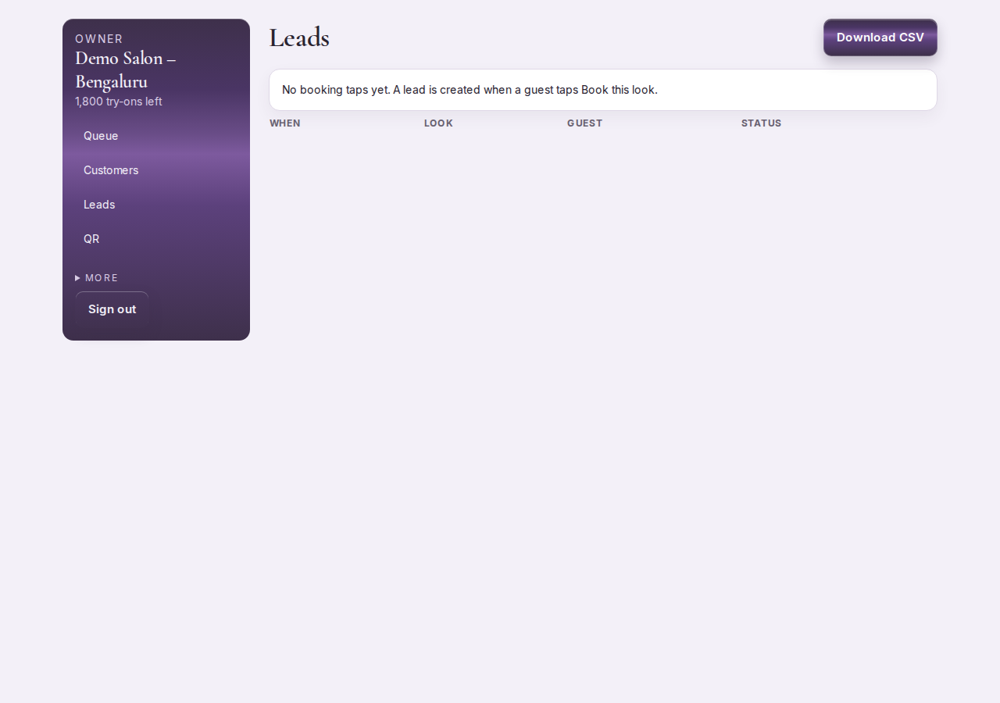

## Owner security

*Owner*

Security is where the owner turns on an authenticator for their own sign-in and can see the session. It does not change the plan or the prices.

**Next.** Turn on the authenticator if the owner password is shared with more than one person. Prefer a staff login instead.

**Rule.** Founder sign-in already requires an authenticator in production. Owner sign-in does not, until the owner turns it on.

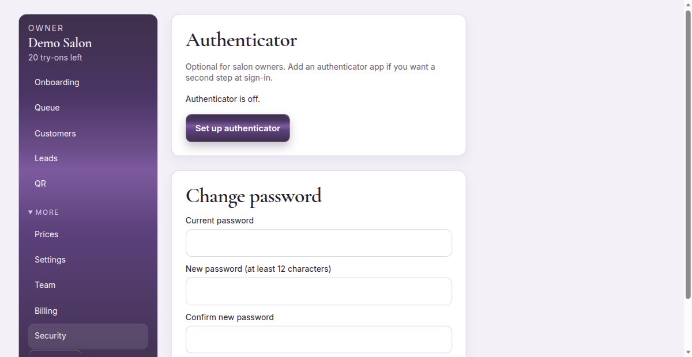

## Staff desk, walk-in, and confirm

*Staff*

On the desk a staff member can add a walk-in with a name and an optional mobile number, call NEXT, tap Start, tap Done, and mark No-show. In request mode the waiting card has Confirm time and Decline. Confirm time moves that guest under Confirmed, with Mark visited for when they arrive. The name stays on the desk so the booking is not lost.

**Next.** Add the walk-in at the chair. Confirm a requested time before the guest is told to come.

**Rule.** Confirming does not take a try-on. It only moves the queue.

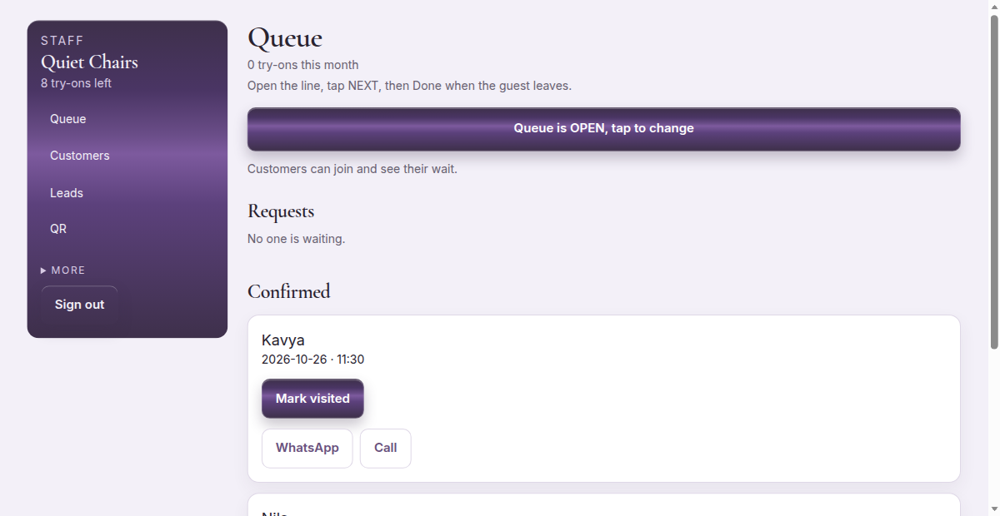

## What staff can and cannot do

*Staff*

Staff sign in to the same desk. They can add a walk-in, call NEXT, start, finish, mark a no-show, and confirm a requested time. Confirm time moves the request into Confirmed, with Mark visited. Settings says staff cannot change settings or prices. Prices says only the owner can change prices. Billing says only the owner can change the plan. The role on the menu reads STAFF.

**Next.** Run the line. Leave prices, bridal, and the plan to the owner.

**Rule.** A confirmed request stays on the desk under Confirmed so the name is not lost. It leaves the waiting list.

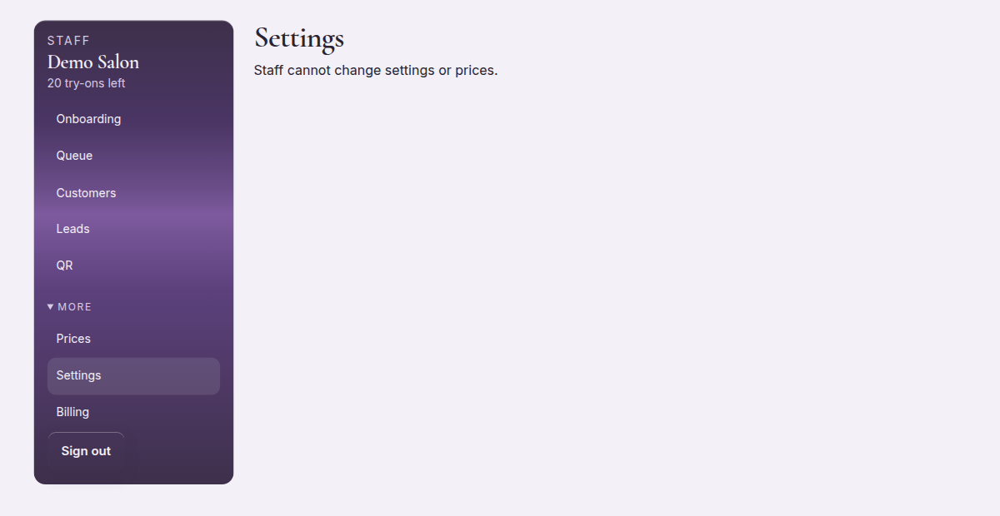

## Founder home and the nine salons

*Super admin*

Founder sign-in asks for the email, the password, and the six-digit authenticator code. The home shows try-ons this month, try-ons left, active salons, trials, and MRR. Salons is the working table: link, plan, status, try-ons left, try-ons this month, trial end, and created date. Search filters by name or slug. Plan filters Basic, Standard, and Pro. Status filters trial, active, suspended, and expired. Attention filters trial ending in 7 days, and low try-ons left (10 or fewer).

**Next.** Search, then open Actions on the row. Do not type into a row to change it.

**Rule.** The table says when no AI key is saved. Customers see sample images until a key is saved and tested.

## Trial, low try-ons, and expired

*Super admin*

Attention has two filters. Trial ending in 7 days lists only those trials. Low try-ons left lists salons with 10 or fewer. Status Expired lists only ended trials, and it hides the live salons. Suspended is its own status. Expired is not the same row as suspended.

**Next.** Use the filter before calling a salon. Clear it before the next search.

**Rule.** A trial that ends moves to Expired. Resume does not bring it back. Mark paid does.

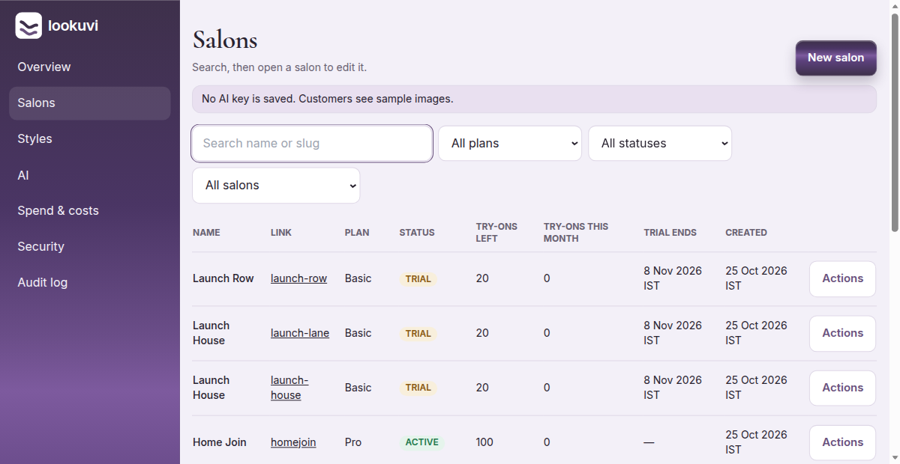

## Adjust try-ons

*Super admin*

Adjust try-ons asks for an amount and a reason. One try-on is one credit. The amount can be negative. The reason is saved on the ledger and the audit log. The new number shows on the salons table and on the owner menu together. A sample image does not move this number. This adjustment does.

**Next.** Type the amount, write the reason, and confirm. Then look at the owner's menu to see the same number.

**Rule.** Adjust try-ons does not activate a plan and it does not write a receipt. Mark paid does those.

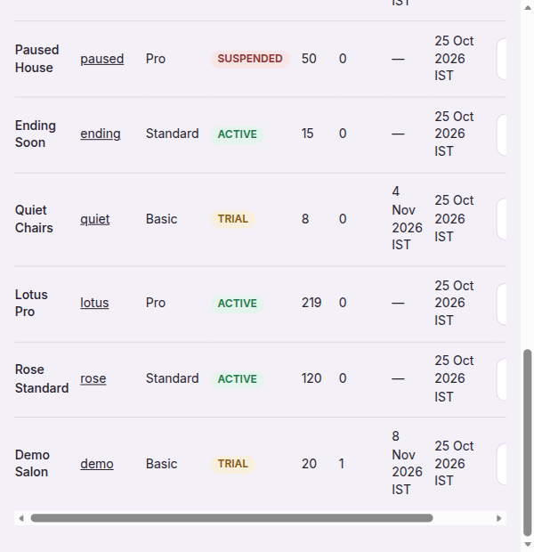

## Change plan, new salon, suspend

*Super admin*

Actions holds Change plan, Mark paid, Adjust try-ons, and Suspend or Resume. Change plan sets the plan and says it does not add try-ons. New salon asks for a name, a slug, a plan, an owner email, and an owner password of at least 12 characters that is not a demo password. Create starts a 14-day trial with 20 try-ons. Suspend shows the guest a paused page. Confirm suspend and Confirm resume are the dialog buttons. Resume opens the guest page again.

**Next.** Create the salon, send the owner their password, and suspend only when the salon should be dark.

**Rule.** A slug cannot be reused. Resume does not extend a trial. An ended trial stays ended until a plan is marked paid.

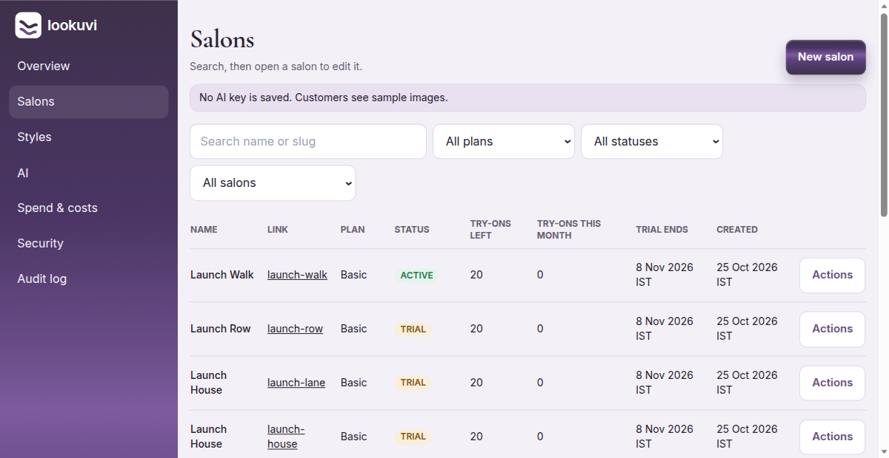

## AI key missing

*Super admin*

AI settings are two rows, OpenAI and fal. Each row has a masked saved state, Save, and Test, and one row is marked In use. The price list under them is the source for the cost maths. With no key saved, the salons page says No AI key is saved. Customers see sample images. Test checks the key. A missing key does not spend try-ons.

**Next.** Paste the provider key, save, test, and mark the row in use. Until Test succeeds, tell salons they are on samples.

**Rule.** A paid provider image is not run in this copy. Samples do not move try-ons left.

## Spend, image log, and style tags

*Super admin*

Spend and costs shows month spend, the image count, and the average rupees per image, then a per-salon table. Image log is a separate page of image costs. Styles lists every platform style with density ticks (thin, medium, thick), texture ticks (straight, wavy, curly), and Save on the row. Saving the first row saves that style. The same ticks are on every later row. These tags are what the guest hair-type chips filter on. The owner cannot edit them.

**Next.** Save a style after its ticks match the photo. Check Spend when a key is live.

**Rule.** Style tags do not spend try-ons. They only change which photos Show all can hide.

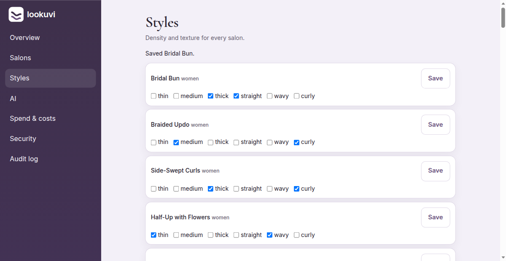

## Audit log and founder security

*Super admin*

The audit log lists founder actions and can filter by action and by salon. Security says the authenticator is required in production and shows that it is on. Founder sign-in will not open the platform without the six-digit code.

**Next.** Filter the log when a salon asks who changed a plan or who marked a payment.

**Rule.** The authenticator secret for this demo is stored with the demo passwords. A production founder uses their own.

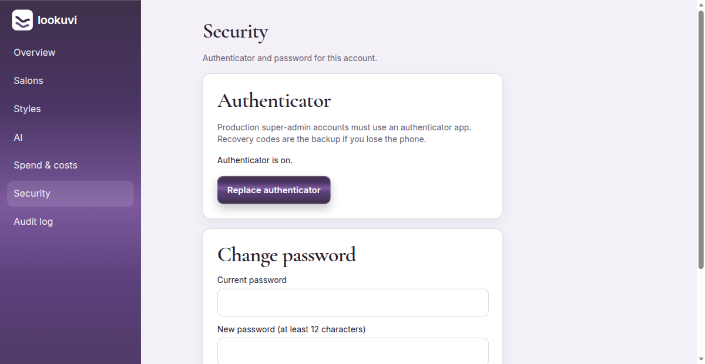

## Mark paid and the receipt

*Super admin*

Mark paid asks for the UPI reference, 6 to 32 letters or digits. It activates the plan, adds the try-ons for that plan, and writes the receipt. The same reference cannot be used again. The owner then sees Download on Billing.

**Next.** Type the reference from the salon's UPI app, mark it paid, and tell the owner the receipt is ready.

**Rule.** Mark paid is the only control that both activates a plan and adds try-ons. Adjust try-ons changes the number without a payment. The reason is stored.

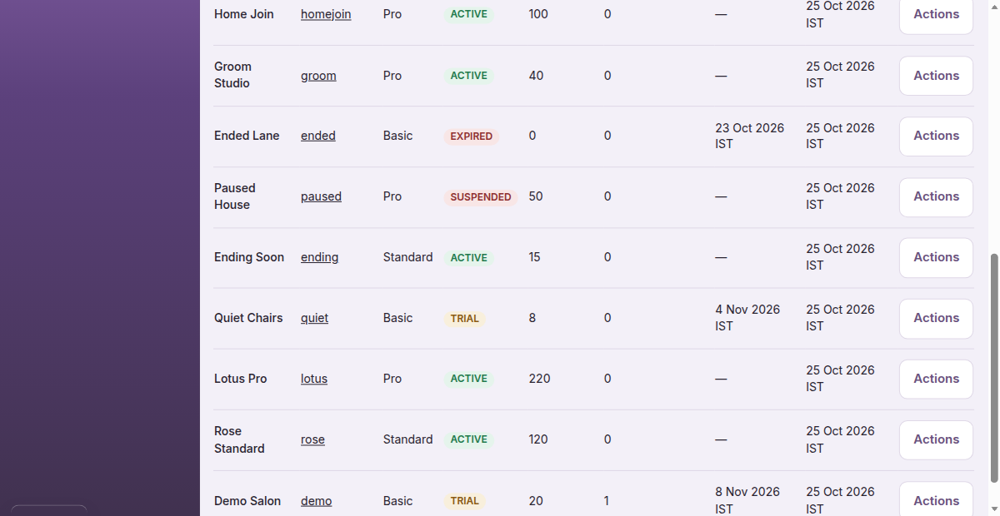

## Two screens at once

*Cross-screen*

A guest join on one screen appears on the desk as the same token. NEXT, Start, Done, and No-show on the desk change the guest ticket. Pausing the desk blocks the next join. A walk-in on one salon does not appear on another salon's desk. A sample try at a salon with no AI key leaves try-ons left where it was. Adjust try-ons by one on the salons table moves the owner menu by the same one.

**Next.** Keep the desk open while the guest joins. Call the token from the desk, not from the guest phone.

**Rule.** Salon data does not cross. Demo's walk-in is not on Lotus. Lotus's try-ons are not Demo's.

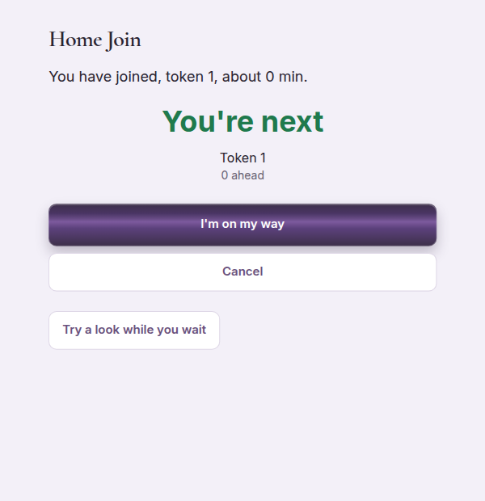

## Not connected on this copy

*Platform*

Five things are shown and not ticked as passed. A printed QR needs a public website address before a phone can scan it. A UPI payment from a real app is not sent. The screen stops at Payment pending and the placeholder lookuvi@upi. A WhatsApp message on a handset is not sent. The product records STOP and shows the paused-reminders banner. A paid provider image is not run. Samples do not spend a try-on. A tax invoice is not issued. GST is off, and the download is a receipt.

**Next.** Connect a public domain, a real UPI id, a Meta WhatsApp number, a provider key, and a GSTIN when those decisions are made.

**Rule.** None of these five block the desk, the mirror, or the founder tools.

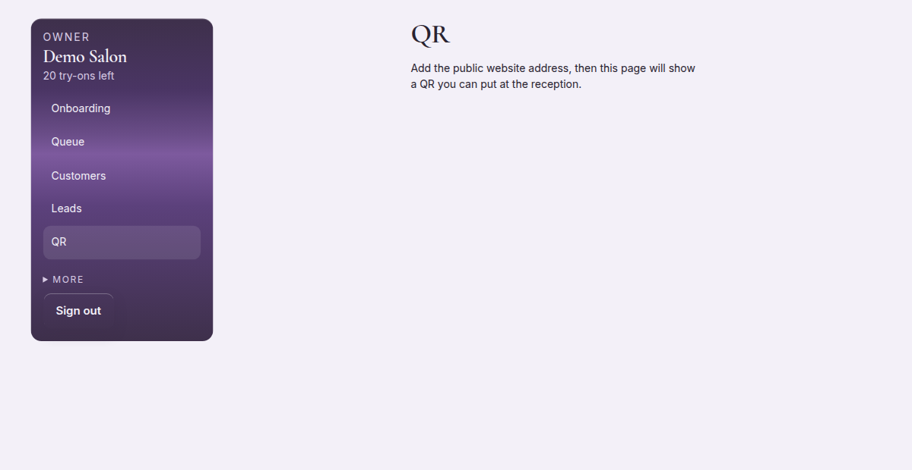

## Questions owners ask

*Owner*

Does Choose turn the plan on? No. It shows Payment pending until a founder marks the UPI reference paid. Does a sample use a try-on? No. Does bridal come with a new salon? No. Turn it on in Settings, then set Classic, Signature, and Royal. Can staff change the price? No. Can the owner edit style tags? No. Those are on the founder Styles page. Where is the language picker for the guest? There is not one. The salon language is the guest language. What does STOP do? It marks the customer Replied STOP and reminders stay off for that number. Why is the QR page empty? The public website address is not saved yet.

**Next.** If a screen disagrees with this page, trust the screen and tell the founder. The screen is the product.

**Rule.** Trial length is 14 days and 20 try-ons. After that the guest sees Trial ended until a plan is marked paid.

## When something looks wrong

*Owner*

Those details did not match: the email or the password is wrong. Wait and try the password again rather than many wrong tries. The queue is paused: the desk switched the line off. Tap the same control to open it. This salon is paused: a founder suspended it. Resume is on the salon's Actions menu. Trial ended: choose a plan and have it marked paid. No visit to unlock yet: the guest has not made a billed bridal or groom try. A sample does not create a visit. Too many joins, or too many previews: the guest should wait a few minutes. The caps are there to protect the salon. Payment pending that never clears: the UPI reference has not been marked paid, or it was already used. Guests cannot try on: the trial ended or the salon is suspended. The owner banner says which.

**Next.** Check the banner at the top of the owner screen first. It names the block.

**Rule.** Do not create a second salon to escape a pause. Resume the one that is paused.

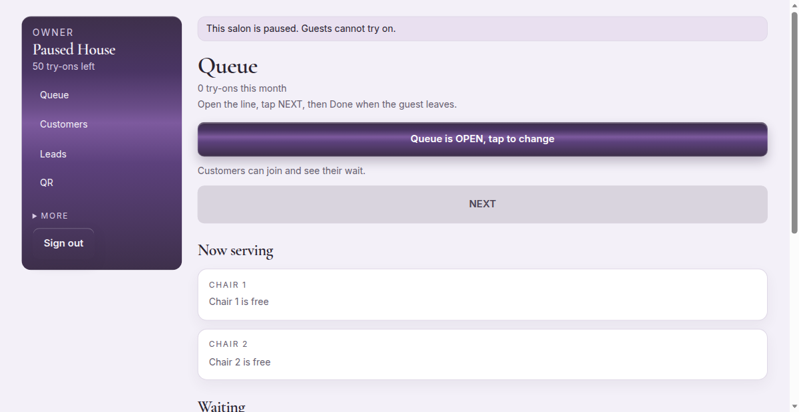

## The owner's first week

*Owner*

Sign in. Finish onboarding and pick the language. Set chairs on the desk. Add the services and the prices. Turn on beard, colour, nails, bridal, or groom only if the salon offers them. Add the staff login. Put the guest link on the mirror once the public address is saved. Choose a plan when the trial should become a paid month, pay by UPI, and send the reference to a founder. Download the receipt. Keep the desk open during the day and call NEXT from the chair.

**Next.** Do the guest link yourself once, as a customer would, before the first appointment.

**Rule.** The three founders can see the salon's try-ons left, the plan, and the audit row for every change they make.

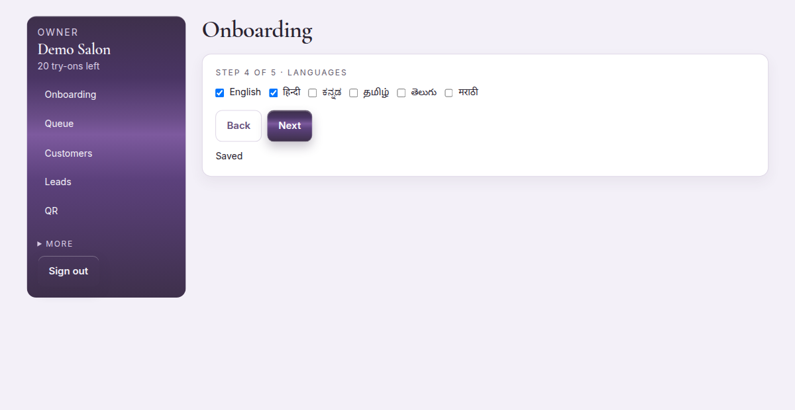

