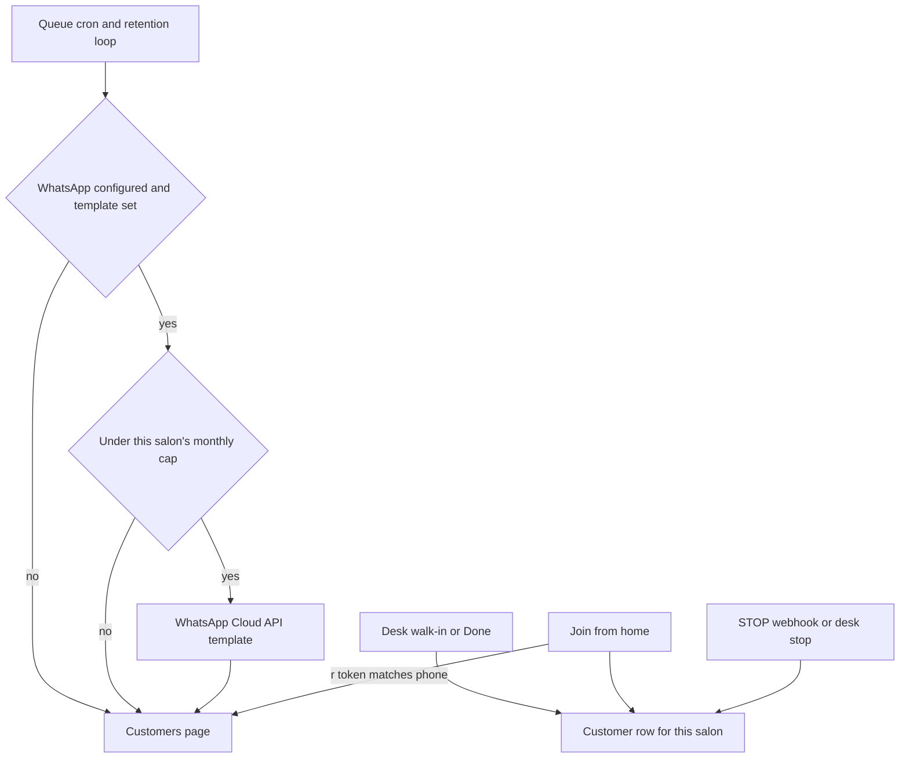

# Return visits architecture

The salon is a `Tenant`. Guests already join a queue in `src/lib/queue/service.ts`. Alerts already go through `notifyGuest` in `src/lib/notify/index.ts`. This feature extends those two paths. It does not add a second sender.

## What is saved

`rememberCustomer` runs when a walk-in is saved with a phone and when a remote join is accepted. The phone is normalised with the existing `indianMobile` helper (`91` plus 10 digits). The unique key is `(tenantId, phone)`, the same key the guest OTP login already uses, so a person who later signs in is the same row. Profile fields used by the guest hub (birthday, people, looks) are left alone. The name is updated only when the new name is non-empty and is not the desk placeholder "Walk-in".

A visit is `recordVisit`, called only from `finishEntry` when the new status is `DONE`. Live "Done" and request-mode "Mark visited" both end there. `NO_SHOW` and cancel do not. `visitCount` increments by one and `lastVisitAt` becomes now. `needsReminder` becomes true.

Imported numbers use the same upsert. A `YYYY-MM-DD` on the line, not in the future and not before 2020-01-01, is stored as noon in Asia/Kolkata. It updates `lastVisitAt` only when the salon does not already have a later visit. `visitCount` becomes at least 1. `needsReminder` becomes true.

## Who can call it

Admin routes use `requireMembership`. The tenant id comes from the session, never from the body. Add, import, search, and desk opt-out are any member of that salon. Interval, cap, and broadcast use `requireOwner`. Another salon's id is not accepted.

## Token messages

`joinedMessage`, `almostMessage`, and `confirmedMessage` keep their current parameters in order and append the join-from-home URL and the try-on URL. The body text includes both, which is what the log provider records when WhatsApp is off. The desk `wa.me` text gets the same two links.

Existing approved templates have fewer variables than this. A template send then fails until the template is updated. Queue behaviour on a failed send is unchanged: the join is still saved, a near-turn alert is retried later, and the failure is logged. Parameter text is capped at 1024 characters, which is the Cloud API limit for one variable.

The desk button is a `wa.me` link on the staff phone. It is not a Cloud API send, so it is not capped and it is not a `WhatsAppSend` row.

Links use `APP_BASE_URL`, the same base as the status link:

- Status: `/s/{slug}/q/{cancelToken}`
- Join from home: `/s/{slug}/queue`
- Try on: `/s/{slug}`

## Reminders

`sweepDueReminders` runs at the end of `POST /api/cron/queue` and inside the retention loop (every 15 minutes in the process, and on `POST /api/cron/retention`). Both paths are safe to run together.

A salon is skipped when reminders are off, the queue product is off, or the salon is suspended. A customer is due when `needsReminder` is true, they are not opted out, and `lastVisitAt` is at least `reminderDays` times 24 hours ago. The interval is a duration, not a calendar date. Each run takes the 40 oldest due customers for that salon.

Claim order, so two instances do not double-send:

1. Set `reminderLockUntil` 15 minutes ahead only if the lock is empty or expired and `needsReminder` is still true. Zero rows means another worker took them.
2. Reserve a monthly slot: in one transaction, expire `PENDING` rows older than 10 minutes, count `SENT` plus fresh `PENDING` for this salon and this Asia/Kolkata month, and insert a `PENDING` row if the count is under `whatsappMonthlyCap`. On Postgres the transaction takes advisory lock `872164` (the rupee spend lock stays `872163`).
3. Send. On WhatsApp success, mark the row `SENT`, clear the lock, set `needsReminder` false, and set `lastRemindedVisitAt`. On failure, mark the row `FAILED`, clear the lock, and leave `needsReminder` true.
4. If the cap is full, clear the lock and stop the salon. Those customers stay due for a later month.

The reservation is released when the send does not succeed, so a failure does not burn the cap. Live queue alerts do not create these rows and do not read the cap. A salon that has used its 50 offers still sends "your token is 4".

If the token or phone id is missing, or `WHATSAPP_TEMPLATE_REMINDER` / `WHATSAPP_TEMPLATE_OFFER` is empty, the sweep does not reserve a slot and does not flip `needsReminder`. The customers page reads `whatsAppConfigured` and the template name and says so.

One reminder per completed visit: success clears `needsReminder`. The next `DONE` sets it again. A broadcast does not clear it.

## Offers

`sendBroadcast` writes a `SalonBroadcast` row, then walks this salon's customers who are not opted out, latest visit first (nulls last), page by page until the cap reservation fails or the list ends. It does not stop at a fixed page and leave the rest uncounted. A later offer is a new broadcast and may message the same people again. One broadcast does not message the same person twice. The offer text is one line, trimmed, at most 180 characters. The message ends with the same STOP line. The join link carries that send's `linkToken`. An offer click is not a reminder return.

## STOP

The Cloud API webhook is `GET/POST /api/whatsapp/webhook`. It is outside the admin CSRF list. `GET` answers the hub challenge when `hub.verify_token` matches `WHATSAPP_VERIFY_TOKEN`. `POST` is accepted only when `X-Hub-Signature-256` matches HMAC-SHA256 of the raw body with `WHATSAPP_APP_SECRET`. A missing secret rejects the call. There is no unsigned mode.

The only opt-out phrases are `STOP`, `STOPALL`, and `UNSUBSCRIBE`, with optional trailing punctuation. `CANCEL` is not an opt-out, because a guest may mean today's token.

Lookuvi sends from one WhatsApp phone id for every salon. A plain STOP is stored for the salon that last sent a reminder, offer, or queue message to that phone. If that cannot be told apart and the phone is saved at exactly one salon, that salon is used. It is not copied onto every salon. STOPALL and UNSUBSCRIBE are the shared-number opt-out: one row with an empty salon id, and every salon with that phone is marked. Meta’s rule is about the business number, so those two words are the way off the sender entirely. The owner cannot undo a STOP. A desk stop is `optOutSource = DESK` on that salon only, and the owner can clear it when no STOP row exists for that salon or for the shared number.

STOP blocks reminders and offers. It does not block the queue alert for a visit the guest just joined with the consent tick.

## Attribution

Each reminder row has a random `linkToken`. The link is `/s/{slug}/queue?r={linkToken}`. The join form reads `r` and posts it with the join. `attributeReturn` counts a return only when the token belongs to this salon, the send status is `SENT`, the kind is `reminder`, and the joining phone is the phone on that send. `CustomerReturn.sendId` is unique, so a second join does not count twice. A forwarded link used with a different phone joins that other person and does not move the metric.

The pilot rate is: distinct customers with a reminder `SENT` in the last 90 days, divided into those who have a `CustomerReturn` for one of those sends. Ninety days is long enough that a 42-day interval still leaves room for the visit to happen inside the window. The screen also shows this month's send counts and this month's returns. The target 20% is copy on the screen, not a gate.

## Try-on allowance

`refuseMonthlyTries` counts `TryOn` rows with status `SUCCEEDED` and an AI preview kind since `kolkataMonthStart` (the same month boundary as the rupee caps). The next preview is refused with `MONTHLY_CAP` when the count is at `monthlyTryAllowance` (default 30, owner range 0 to 5000). The check sits beside the existing daily salon cap in the try-on, bridal-own, and groom routes, before the provider is called. Staff are included. Zero means no included try-ons. If the owner lowers the allowance below the number already used this month, the next preview is refused until the month turns or they raise it.

Per person, the existing caps stay and are the per-customer daily cap:

- Signed in: `memberDailyCap` (default 30), keyed by customer id.
- Not signed in: `anonDailyCap` (default 8), keyed by IP hash.
- Salon mode: no per-person cap.

Try-on requests do not carry a queue phone, so there is no extra daily cap keyed by the customer list. Adding one would be a new identity on the preview request and is not part of this change.

`beginPaidCall` is unchanged. `AI_SPEND_CAP_INR` and `AI_SALON_SPEND_CAP_INR` still refuse a paid call when the rupee reserve would pass the cap. A salon can hit either the count or the rupees first.

## Failure

WhatsApp HTTP errors, missing templates, and a dead webhook secret do not throw into the queue join. Join and Done commit even if the message is not sent. Logs keep the last four digits of a phone, which `sendLog` already does.
